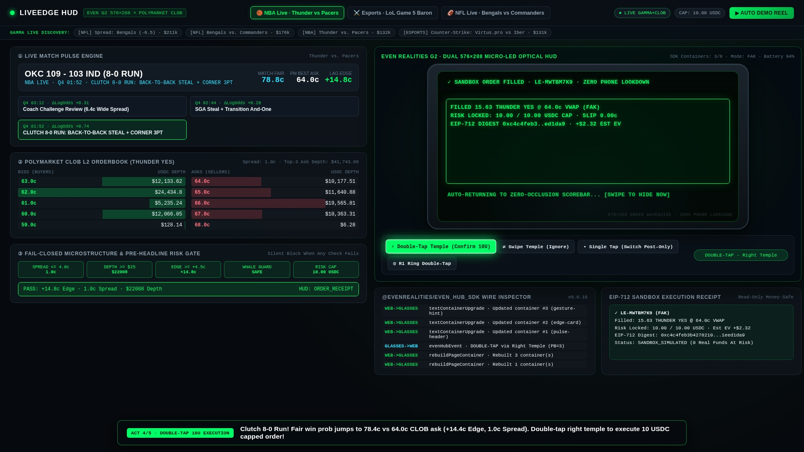
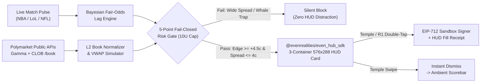

# LiveEdge HUD — Heads-Up Sports & Esports Pulse Execution for Even Realities G2

> **Watch the match, not your phone.** LiveEdge HUD streams real-time Polymarket CLOB orderbook depth to **Even Realities G2** dual `576×288` micro-LED smart glasses, silently filtering out wide-spread noise and popping a high-contrast 3-line green HUD card **only** when a live match swing creates a clean, risk-gated lag edge — executable with a single **Temple Double-Tap** or **Even R1 Ring** gesture.

Built for the **Heads Up: Even Realities Hackathon** (`Track 02 · Crypto & DeFi`).



---

## Why LiveEdge HUD?

During decisive live sports and esports moments — an **NBA clutch 8-0 run**, a **League of Legends Baron Nashor steal**, or an **NFL goal-line interception** — looking down to unlock a phone, open a trading app, check orderbook spread, and type order sizes takes 12–20 seconds: you miss the live action **and** the repricing window.

**LiveEdge HUD** turns Even Realities G2 into a zero-occlusion, fail-closed execution heads-up display:

1. **Zero-Occlusion Ambient Mode (`IDLE_SCOREBAR`)**: Keeps 88% of the `576×288` optical waveguide completely dark/transparent with only a dim (`textColor: 2`) single-line top score ticker.
2. **Real Polymarket Gamma + CLOB L2 Engine**: Discovers active NBA, NFL, and Esports markets live from Polymarket Gamma (`/events` + `/markets`) and streams L2 orderbooks (`/book`), normalizing wire bids/asks best-first and computing multi-rung VWAP slippage (plus deterministic historical L2 replay for offseason championship swings).
3. **6-Check Fail-Closed Risk Gate (Silent Block)**: Automatically blocks noisy micro-events or malformed inputs without popping any HUD notification when:
   - Numeric stake / risk-cap inputs are non-finite or violate the **`10.00 USDC` Fixed Risk Cap** (`RISK_CAP_VIOLATION`)
   - Bid-ask spread exceeds `4.0c` (`SPREAD_TOO_WIDE`)
   - Top-of-book executable ask liquidity is below `$25 USDC` (`INSUFFICIENT_DEPTH`)
   - Pre-Headline Counter-Whale / Cui-Bono Sentinel detects `>= $1,000` adverse smart-money flow (`WHALE_TOXICITY_ALERT`)
   - Match-state lag edge (`Implied Fair Prob - Best Ask`) is under `+4.5c` (`EDGE_BELOW_THRESHOLD`)
4. **Blind Temple & Even R1 Ring Gestures (`@evenrealities/even_hub_sdk` v0.0.16)**:
   - **`Double-Tap` (`DOUBLE_CLICK_EVENT`)**: Confirm risk-capped `10.00 USDC` sandbox order (`FAK` or `POST_ONLY`) and render instant VWAP + EIP-712 receipt on the HUD.
   - **`Swipe` (`SCROLL_TOP_EVENT` / `SCROLL_BOTTOM_EVENT`)**: Dismiss active alert immediately back to unobstructed match viewing.
   - **`Single Tap` (`CLICK_EVENT`)**: Toggle `FAK` vs `POST_ONLY` execution mode on the live card.
   - **Root `Double-Tap` / Menu Exit**: Invokes `bridge.shutDownPageContainer(1)` per Even Hub QA lifecycle guidelines.

---

## System Architecture



---

## Official Even Realities G2 SDK & `.ehpk` Compliance

- **SDK**: `@evenrealities/even_hub_sdk` (`0.0.16`) + `@evenrealities/evenhub-cli` (`0.2.0`)
- **Manifest (`app.json`)**: `package_id: io.redkoi.liveedgehud`, `edition: "202601"`, `min_sdk_version: "0.0.16"`, `min_app_version: "2.2.10"`, explicit network domain whitelist (`gamma-api.polymarket.com`, `clob.polymarket.com`).
- **Display Geometry**: Strict `576 × 288` coordinate bounds, explicit `zOrderIndex` across all containers, brightness levels `0..4`, and single `isEventCapture: 1` container validated via `validateEvenHubPageContainer()` prior to every native bridge call.
- **Icon Spec (`icon.png`)**: Exact `24×24` PNG with transparent background and `#F4F4F4` `2×2` raster-aligned pixel blocks.
- **Money Safety**: 100% read-only market data + zero-key EIP-712 sandbox execution mode (`SANDBOX_SIM`) by default, conforming to Polymarket `CTFExchange.sol` `Order` typed-data (`Order.side: uint8(0)` for `BUY`, post-wallet-sync digest verification) with optional `window.ethereum` (`eth_signTypedData_v4`) testnet signing interface. No private keys, cookies, or user funds are ever stored or risked.

---

## Quick Start

### 1. Install & Run Interactive G2 Studio

```bash
npm install
npm run dev
```

Open `http://localhost:5173` (or `http://localhost:5173/?demo=1` for the automated 5-act broadcast reel).

### 2. Run on EvenHub Simulator or Paired G2 Glasses

```bash
# Option A: Launch with official EvenHub Simulator
npx @evenrealities/evenhub-simulator http://localhost:5173

# Option B: Sideload via QR code in Even App Dev Mode
npx evenhub qr --url http://<YOUR_LAN_IP>:5173
```

### 3. Run Full Verification & Build `.ehpk` Bundle

```bash
# Runs TypeScript strict check, ESLint, Vitest unit/SDK tests, Vite build,
# evenhub pack (.ehpk), desensitization scan, and headless Playwright E2E test:
npm run check:all
```

Packaged output: `release/liveedge-hud.ehpk`

---

## Project Structure

- `app.json` / `icon.png` — Even Hub manifest and strict `24×24` `#F4F4F4` `2×2`-block icon
- `src/engine/polymarketClient.ts` — Live Polymarket Gamma/CLOB L2 orderbook client & multi-rung VWAP math
- `src/engine/pulseEngine.ts` — Bayesian log-odds match swing calculator (NBA, LoL Esports, NFL)
- `src/engine/riskGate.ts` — 5-point fail-closed microstructure & Pre-Headline Whale Sentinel (`10 USDC` hard cap)
- `src/engine/sandboxSigner.ts` — Standard EIP-712 Polymarket CTF Order typed-data builder & sandbox execution receipt generator
- `src/hud/evenBridgeController.ts` — Official `@evenrealities/even_hub_sdk` `576×288` container manager & temple/ring gesture state machine
- `src/hud/mockFlutterHost.ts` — Spec-faithful `flutter_inappwebview` host adapter for browser preview & automated E2E testing
- `src/ui/` — Split-screen Live Telemetry + CLOB Depth Ladder + `576×288` Waveguide Lens Studio
- `tests/` — Vitest unit tests covering CLOB normalization, Risk Gate fail-closed branches, EIP-712 digests, and Even Hub SDK layout/gesture compliance

---

## License

MIT © 2026 RedKoi Research. Built for educational and hackathon demonstration purposes only (read-only Polymarket market data + paper/sandbox execution; not financial advice).
